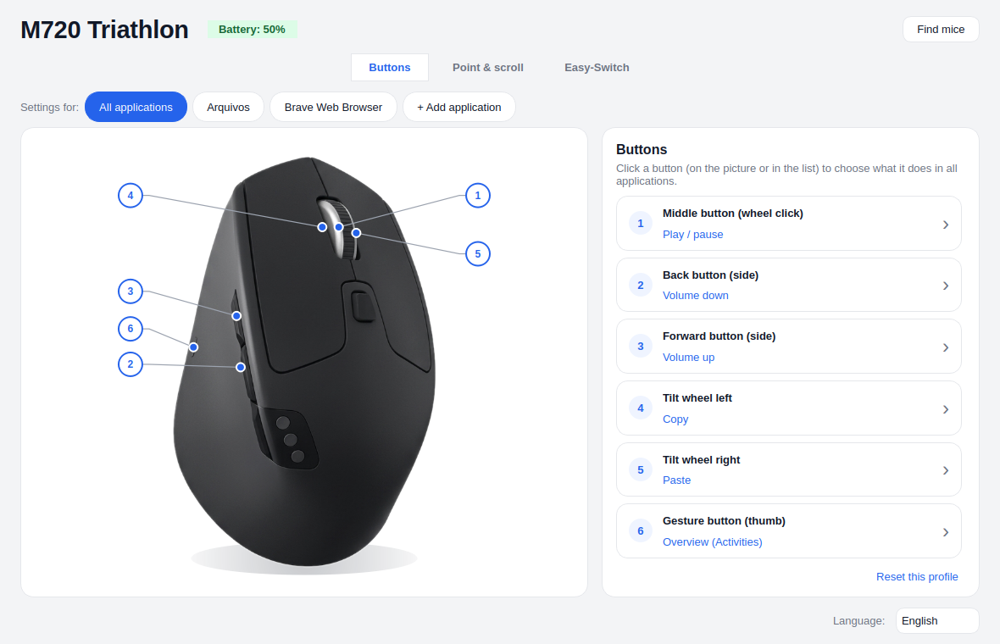
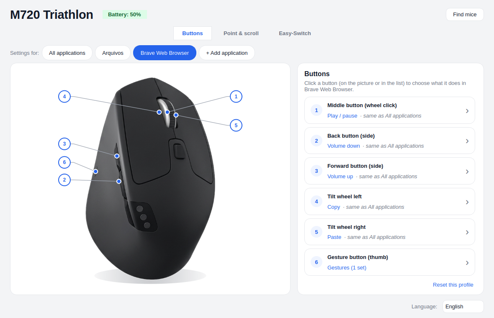
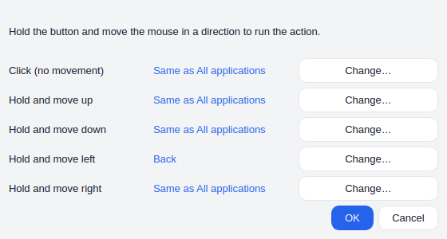
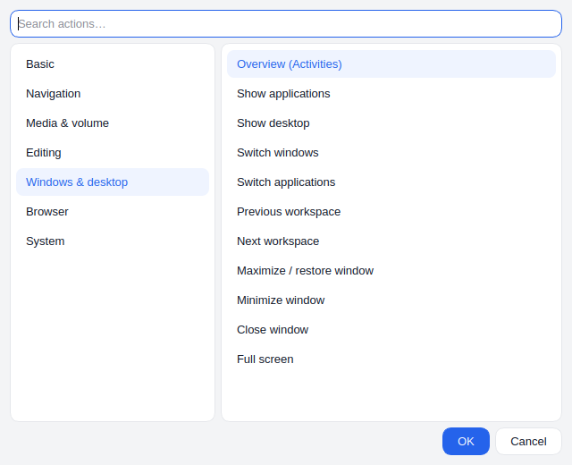

# Mouse Options

**Configure your Logitech mouse on Linux the easy way — like Logi Options+, but native and free software.**

*[Leia em português](README.pt-BR.md)*

Click a button on the picture of your mouse and choose what it should do. Set different actions per
application, use hold-and-move gestures, adjust pointer speed, DPI, scrolling and SmartShift, and switch
between computers with Easy-Switch — all from one window, with changes applied instantly.



## Features

- **Visual button setup** — every programmable button of the mouse appears on its picture and in a list.
- **Over 50 ready-made actions** in categories: media and volume, navigation, editing, windows and
  workspaces, browser, system (screenshot, lock screen, brightness, calculator…). Or use any keyboard
  shortcut, open an application or run a command.
- **Per-application profiles** — e.g. the side button lowers the volume everywhere but goes *back* in the
  file manager. Whatever a profile does not change follows "All applications".
- **Gestures** — hold the gesture button (or any button that supports it) and move the mouse up, down,
  left or right; a simple click keeps its own action.
- **Pointer & scroll** — pointer speed (stored in the mouse), DPI, scroll direction, smooth (high-resolution)
  scrolling, SmartShift (when the wheel unlocks to free-spin) and thumb-wheel direction. Only the settings
  your mouse actually has are shown.
- **Easy-Switch** — see the names of the paired computers and switch channel from the app.
- **Unifying receiver** — see what is paired, pair a new mouse or keyboard and unpair, right from the app.
- **Fast and smooth** — its own HID++ service talks directly to the mouse (no Solaar needed). Buttons are
  ready ~0.2–0.4 s after the mouse connects, and actions use direct system calls (D-Bus, PipeWire, GNOME
  Shell) instead of fake keystrokes whenever possible, avoiding the stutters that simulated keys cause.
- **Wayland and X11** — a small GNOME Shell extension (included) shows the native volume/brightness pop-ups,
  runs window actions and tells the service which app is in focus on Wayland.
- **Imports your Solaar rules** the first time it sees a mouse.
- Interface in **English and Portuguese**.

| Per-application profiles | Gestures | Action catalog |
|---|---|---|
|  |  |  |

## Supported devices

| Device | Status |
|---|---|
| **Logitech M720 Triathlon** (Bluetooth and Unifying receiver) | ✅ Tested daily, with its own picture |
| **Other Logitech mice with HID++ 2.0** — MX Master, MX Anywhere, MX Vertical, Lift, M650, M590, ERGO trackballs… | 🟡 Should work: buttons and settings are read from the mouse itself. Not tested on real hardware yet; shown with a generic drawing |
| **Unifying receiver** | ✅ Tested |
| **Bolt receiver** | 🟡 Should work (the Linux kernel handles it), untested |
| **Keyboards** (MX Keys, K-series…) | ❌ Not yet — detected but ignored. See [Contributing](#contributing) |
| Presenters, webcams, headsets | ❌ Not yet |
| Logitech G (gaming) devices | Out of scope (G Hub territory) |

**Tried it with another mouse?** Please [open a device report](../../issues/new?template=device-report.md) —
whether it worked or not. That is how the "should work" rows turn green.

## Installation

Requirements: Ubuntu 24.04 or newer, Zorin OS 18, or another Debian-based distribution with Python 3.10+
and PyQt6. The GNOME Shell extension supports GNOME 46–50.

1. Download `mouse-options_<version>_all.deb` from the [latest release](../../releases/latest).
2. Install it:

   ```sh
   sudo apt install ./mouse-options_*_all.deb
   ```

3. **Log out and back in** (so GNOME loads the extension), then open **Mouse Options** from the
   applications menu.

If Solaar is running, Mouse Options asks to turn off its autostart so the two don't fight over the mouse.

**Updating:** install the new `.deb` the same way, then log out and back in (or run
`systemctl --user restart mouse-optionsd`) so the running service picks up the new version.

To remove: `sudo apt remove mouse-options`.

## How it works

```
┌───────────────┐   D-Bus   ┌────────────────────┐   hidraw (HID++)   ┌──────────┐
│  Mouse Options│◀─────────▶│  mouse-optionsd    │◀──────────────────▶│  mouse / │
│  (Qt window)  │           │  (user service)    │                    │ receiver │
└───────────────┘           └─────────┬──────────┘                    └──────────┘
                                      │ D-Bus
                            ┌─────────▼──────────┐
                            │ GNOME Shell        │  focus, OSD, windows,
                            │ extension          │  overview, screenshot
                            └────────────────────┘
```

- **`mouse-optionsd`** (systemd user service, `mouse_options/daemon/`) finds Logitech devices through udev,
  speaks HID++ 2.0 (and HID++ 1.0 for receivers) over `/dev/hidraw*`, diverts the buttons you configured
  and runs the actions. It re-applies everything when the mouse reconnects.
- **The window** (`mouse_options/gui.py`) only edits `~/.config/mouse-options/config.json` and talks to
  the service over D-Bus.
- **The GNOME Shell extension** (`extension/`) runs shell-side actions and reports the focused app.
- A udev rule gives the logged-in user access to Logitech hidraw devices and `/dev/uinput` (used only when
  an action has to simulate keys).
- **`mouse-options-bt-repair`** (small system service, `packaging/bt-repair.py`) fixes a BlueZ problem: if
  a Bluetooth LE mouse disconnects while its HID descriptor is being read, BlueZ caches the truncated
  descriptor and the kernel rejects the mouse on every reconnect (`item fetching failed`). The service
  watches the kernel log and, when that happens, stops BlueZ, deletes only that device's GATT cache (the
  pairing is kept) and starts BlueZ again.

## Known limitations

- **Only the M720 has a picture.** Other mice use a generic drawing with numbered buttons.
- **Keyboards are not supported yet.**
- **GNOME on Wayland:** the window runs through XWayland so it gets the system's native title bar (Qt draws
  its own on Wayland). It may look slightly soft with fractional scaling.
- **Bluetooth:** a truncated HID descriptor in BlueZ's cache is repaired automatically (see above); if the
  mouse still fails afterwards, remove and re-pair it. Do not set `Cache = no` under `[GATT]` in
  `/etc/bluetooth/main.conf`: BlueZ then forgets the mouse's services and stops reconnecting it
  automatically (after suspend, power-cycle or Easy-Switch).

## Contributing

**Mouse Options can become the Logitech super-app for Linux — and it needs you.** The core (HID++ service,
action engine, per-app profiles, GNOME integration) is in place; most of what is missing is adding
devices. Ideas where help is very welcome:

- **Test your mouse** and send a [device report](../../issues/new?template=device-report.md).
- **Add a picture of your mouse** — a PNG with transparent background in `mouse_options/images/` and the
  button positions in `mouse_options/art.py` (`Art(...)` + `MODELS`). Please use your own photo or a
  drawing you are allowed to share — **not** images from Logitech's website.
- **Keyboards (MX Keys and friends):** F-keys and media keys, Fn inversion, backlight, Easy-Switch. The
  HID++ layer (`mouse_options/hidpp/`) already speaks the protocol; the service currently skips devices
  that are not pointing devices (`POINTING` in `daemon/manager.py`).
- **Bolt receivers:** pairing and unpairing from the app (Unifying already works; Bolt uses a different
  flow with a passkey), and testing in general.
- **Presenters** (Spotlight), **more languages**, **packaging** for Fedora/Arch/Flatpak.

### Development

```sh
git clone https://github.com/walbertfreitas/mouse-options
cd mouse-options
packaging/install-dev.sh          # runs the service and the app straight from the source tree
python3 -m unittest discover -s tests
packaging/build-deb.sh            # builds dist/mouse-options_<version>_all.deb
```

The tests use a simulated HID++ mouse (`tests/fake_hidpp.py`), so they run without hardware. To see what
the service is doing: `journalctl --user -u mouse-optionsd -f` (set `MOUSE_OPTIONS_DEBUG=1` in the unit
for more detail). Code comments are in Portuguese; issues and pull requests are welcome in English or
Portuguese.

## License

[GPL-3.0-or-later](LICENSE). If you distribute a modified version, you must publish its source code under
the same license — so improvements come back to everyone.

The table of Logitech control names (`mouse_options/hidpp/names.py`) comes from
[Solaar](https://github.com/pwr-Solaar/Solaar) (GPL-2.0-or-later), whose work documenting HID++ made this
project possible.

*Mouse Options is an independent project, not affiliated with or endorsed by Logitech. Logitech, Logi,
Options+, Unifying, Bolt, MX Master, MX Keys and other names are trademarks of their respective owners.*
