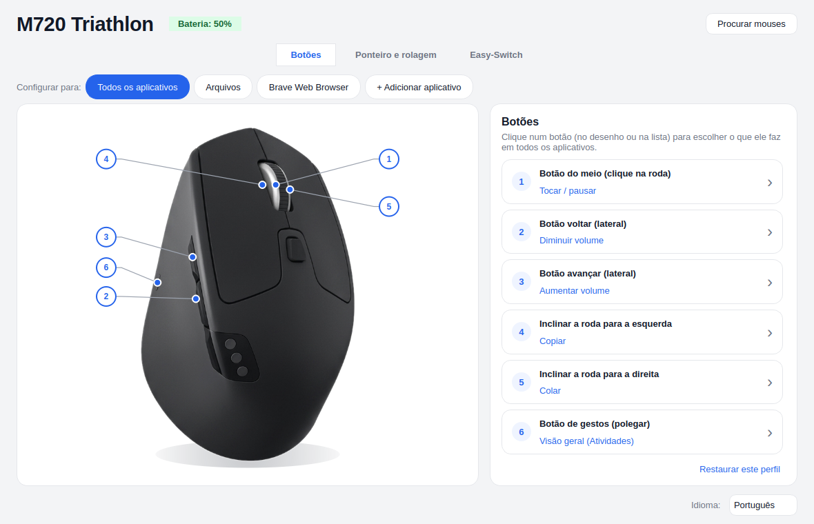
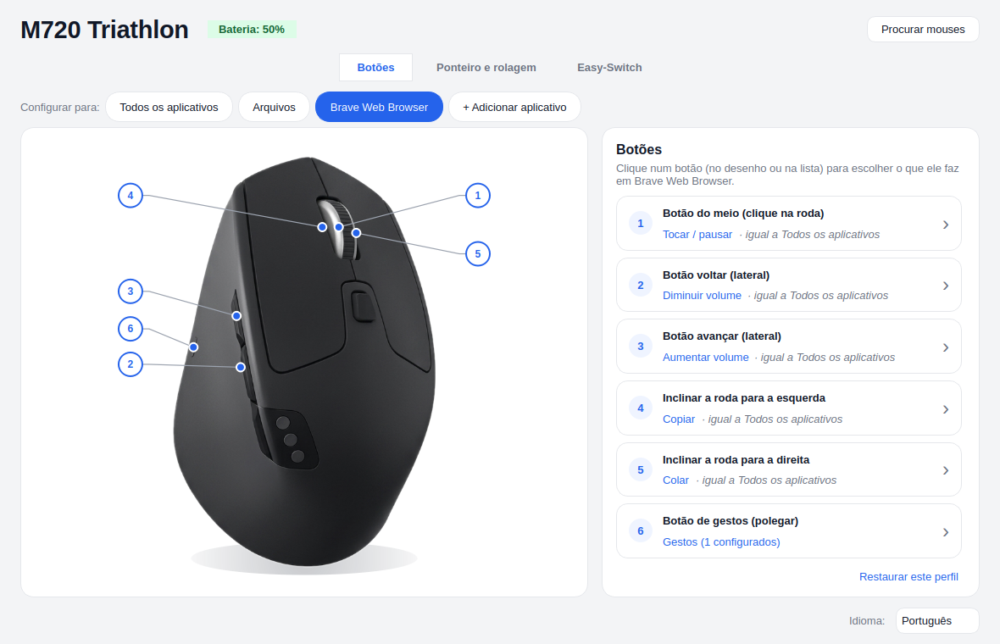
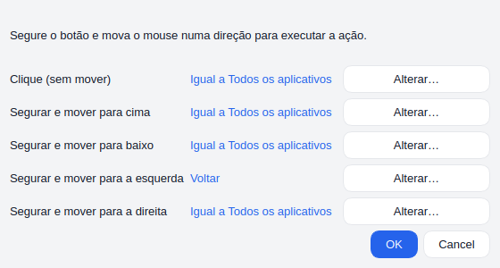
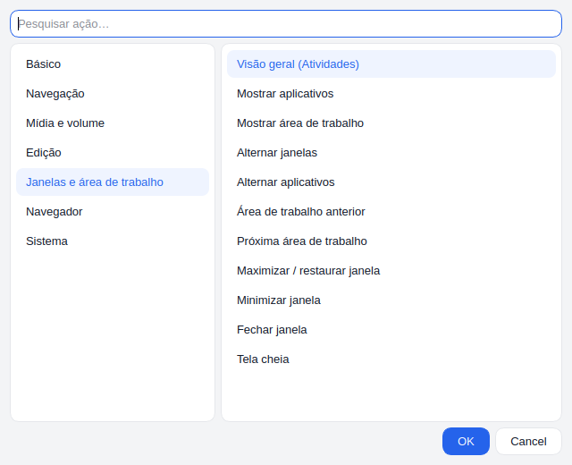

# Mouse Options

**Configure seu mouse Logitech no Linux do jeito fácil — como o Logi Options+, mas nativo e software livre.**

*[Read in English](README.md)*

Clique num botão na foto do mouse e escolha o que ele faz. Use ações diferentes em cada aplicativo, gestos
de segurar e mover, ajuste velocidade do ponteiro, DPI, rolagem e SmartShift, e troque de computador com o
Easy-Switch — tudo numa janela só, com as mudanças valendo na hora.



## Recursos

- **Configuração visual dos botões** — cada botão programável aparece na foto do mouse e numa lista.
- **Mais de 50 ações prontas** em categorias: mídia e volume, navegação, edição, janelas e áreas de
  trabalho, navegador, sistema (captura de tela, bloquear a tela, brilho, calculadora…). Ou qualquer atalho
  de teclado, abrir um aplicativo ou executar um comando.
- **Perfis por aplicativo** — por exemplo, o botão lateral abaixa o volume em todo lugar, mas *volta* no
  gerenciador de arquivos. O que um perfil não muda segue "Todos os aplicativos".
- **Gestos** — segure o botão de gestos (ou outro que aceite) e mova o mouse para cima, baixo, esquerda ou
  direita; o clique simples continua com a ação dele.
- **Ponteiro e rolagem** — velocidade do ponteiro (gravada no mouse), DPI, direção da rolagem, rolagem
  suave (alta resolução), SmartShift (quando a roda passa a girar solta) e direção da roda do polegar. Só
  aparecem os ajustes que o seu mouse tem.
- **Easy-Switch** — veja o nome dos computadores pareados e troque de canal pelo app.
- **Receptor Unifying** — veja o que está pareado, pareie um mouse ou teclado novo e despareie, pelo próprio
  app.
- **Rápido e fluido** — serviço HID++ próprio, que conversa direto com o mouse (sem precisar do Solaar). Os
  botões ficam prontos ~0,2–0,4 s depois que o mouse conecta, e as ações usam chamadas diretas ao sistema
  (D-Bus, PipeWire, GNOME Shell) em vez de simular teclas sempre que dá, evitando as travadinhas que teclas
  simuladas causam.
- **Wayland e X11** — uma pequena extensão do GNOME Shell (inclusa) mostra os avisos nativos de volume e
  brilho, executa as ações de janela e diz ao serviço qual app está em foco no Wayland.
- **Importa suas regras do Solaar** na primeira vez que vê um mouse.
- Interface em **português e inglês**.

| Perfis por aplicativo | Gestos | Catálogo de ações |
|---|---|---|
|  |  |  |

## Aparelhos

| Aparelho | Situação |
|---|---|
| **Logitech M720 Triathlon** (Bluetooth e receptor Unifying) | ✅ Testado no dia a dia, com foto própria |
| **Outros mouses Logitech com HID++ 2.0** — MX Master, MX Anywhere, MX Vertical, Lift, M650, M590, trackballs ERGO… | 🟡 Devem funcionar: botões e ajustes são lidos do próprio mouse. Ainda sem teste com o aparelho real; aparecem num desenho genérico |
| **Receptor Unifying** | ✅ Testado |
| **Receptor Bolt** | 🟡 Deve funcionar (o kernel do Linux cuida dele), sem teste |
| **Teclados** (MX Keys, linha K…) | ❌ Ainda não — são detectados e ignorados. Veja [Como contribuir](#como-contribuir) |
| Apresentadores, webcams, headsets | ❌ Ainda não |
| Linha Logitech G (gamer) | Fora do escopo (é território do G Hub) |

**Testou com outro mouse?** [Abra um relato de aparelho](../../issues/new?template=device-report.md) —
funcionando ou não. É assim que as linhas "deve funcionar" ficam verdes.

## Instalação

Requisitos: Ubuntu 24.04 ou mais novo, Zorin OS 18, ou outra distribuição baseada no Debian com Python 3.10+
e PyQt6. A extensão do GNOME Shell funciona no GNOME 46 a 50.

1. Baixe o `mouse-options_<versão>_all.deb` da [versão mais recente](../../releases/latest).
2. Instale:

   ```sh
   sudo apt install ./mouse-options_*_all.deb
   ```

3. **Saia da sessão e entre de novo** (para o GNOME carregar a extensão) e abra o **Mouse Options** pelo
   menu de aplicativos.

Se o Solaar estiver aberto, o Mouse Options oferece desligá-lo, para os dois não brigarem pelo mouse.

**Para atualizar:** instale o `.deb` novo do mesmo jeito e depois saia da sessão e entre de novo (ou rode
`systemctl --user restart mouse-optionsd`), para o serviço que está rodando passar a usar a versão nova.

Para remover: `sudo apt remove mouse-options`.

## Como funciona

```
┌───────────────┐   D-Bus   ┌────────────────────┐   hidraw (HID++)   ┌──────────┐
│ Mouse Options │◀─────────▶│  mouse-optionsd    │◀──────────────────▶│  mouse / │
│ (janela Qt)   │           │  (serviço)         │                    │ receptor │
└───────────────┘           └─────────┬──────────┘                    └──────────┘
                                      │ D-Bus
                            ┌─────────▼──────────┐
                            │ extensão do        │  foco, avisos, janelas,
                            │ GNOME Shell        │  visão geral, captura
                            └────────────────────┘
```

- **`mouse-optionsd`** (serviço de usuário do systemd, `mouse_options/daemon/`) encontra os aparelhos
  Logitech pelo udev, fala HID++ 2.0 (e HID++ 1.0 com receptores) pelo `/dev/hidraw*`, desvia os botões
  configurados e executa as ações. Reaplica tudo quando o mouse reconecta. Logo depois que um mouse
  Bluetooth conecta (em geral na volta da suspensão), também vigia se a ligação travou — conectado para o
  BlueZ, mas nada passa — e pede ao BlueZ para desconectá-lo, para que reconecte limpo
  (`daemon/watchdog.py`).
- **A janela** (`mouse_options/gui.py`) só edita o `~/.config/mouse-options/config.json` e conversa com o
  serviço pelo D-Bus.
- **A extensão do GNOME Shell** (`extension/`) executa as ações do lado do GNOME e informa o app em foco.
- Uma regra do udev dá à pessoa logada acesso aos aparelhos Logitech e ao `/dev/uinput` (usado só quando
  uma ação precisa simular teclas).
- **`mouse-options-bt-repair`** (pequeno serviço do sistema, `packaging/bt-repair.py`) corrige um problema
  do BlueZ: se um mouse Bluetooth LE desconecta enquanto o descritor HID está sendo lido, o BlueZ guarda o
  descritor cortado e o kernel recusa o mouse em toda reconexão (`item fetching failed`). O serviço
  acompanha o log do kernel e, quando isso acontece, para o BlueZ, apaga só o cache GATT daquele aparelho
  (o pareamento fica) e liga o BlueZ de novo.

## Limitações conhecidas

- **Só o M720 tem foto.** Os outros mouses usam um desenho genérico com os botões numerados.
- **Teclados ainda não são suportados.**
- **GNOME no Wayland:** a janela roda pelo XWayland para usar a barra de título do sistema (no Wayland o Qt
  desenha a dele). Com escala fracionada pode ficar um pouco menos nítida.
- **Bluetooth:** um descritor HID cortado no cache do BlueZ é reparado automaticamente (veja acima); se o
  mouse continuar falhando depois disso, remova e pareie de novo. Não use `Cache = no` na seção `[GATT]`
  do `/etc/bluetooth/main.conf`: o BlueZ passa a esquecer os serviços do mouse e deixa de reconectá-lo
  sozinho (depois da suspensão, de desligar e ligar o mouse ou do Easy-Switch).

## Como contribuir

**O Mouse Options pode virar o super-app da Logitech no Linux — e precisa de você.** A base (serviço HID++,
motor de ações, perfis por app, integração com o GNOME) está pronta; o que mais falta é incluir aparelhos.
Ideias em que a ajuda é muito bem-vinda:

- **Teste o seu mouse** e mande um [relato de aparelho](../../issues/new?template=device-report.md).
- **Adicione a foto do seu mouse** — um PNG com fundo transparente em `mouse_options/images/` e a posição
  dos botões em `mouse_options/art.py` (`Art(...)` + `MODELS`). Use uma foto sua ou um desenho que você
  possa compartilhar — **não** imagens do site da Logitech.
- **Teclados (MX Keys e companhia):** teclas F e de mídia, inverter o Fn, luz das teclas, Easy-Switch. A
  camada HID++ (`mouse_options/hidpp/`) já fala o protocolo; hoje o serviço pula aparelhos que não são de
  apontar (`POINTING` em `daemon/manager.py`).
- **Receptores Bolt:** parear e desparear pelo app (no Unifying já funciona; o Bolt usa outro fluxo, com
  senha) e testes em geral.
- **Apresentadores** (Spotlight), **mais idiomas**, **pacotes** para Fedora/Arch/Flatpak.

### Desenvolvimento

```sh
git clone https://github.com/walbertfreitas/mouse-options
cd mouse-options
packaging/install-dev.sh          # roda o serviço e o app direto do código-fonte
python3 -m unittest discover -s tests
packaging/build-deb.sh            # gera dist/mouse-options_<versão>_all.deb
```

Os testes usam um mouse HID++ simulado (`tests/fake_hidpp.py`), então rodam sem aparelho. Para ver o que o
serviço está fazendo: `journalctl --user -u mouse-optionsd -f` (com `MOUSE_OPTIONS_DEBUG=1` na unit, mais
detalhes). Os comentários do código são em português; issues e pull requests são bem-vindos em português
ou inglês.

## Licença

[GPL-3.0 ou posterior](LICENSE). Quem distribuir uma versão modificada precisa publicar o código-fonte dela
com a mesma licença — assim as melhorias voltam para todo mundo.

A tabela de nomes dos controles Logitech (`mouse_options/hidpp/names.py`) vem do
[Solaar](https://github.com/pwr-Solaar/Solaar) (GPL-2.0 ou posterior), cujo trabalho documentando o HID++
tornou este projeto possível.

*O Mouse Options é um projeto independente, sem vínculo com a Logitech nem endossado por ela. Logitech,
Logi, Options+, Unifying, Bolt, MX Master, MX Keys e outros nomes são marcas de seus respectivos donos.*
